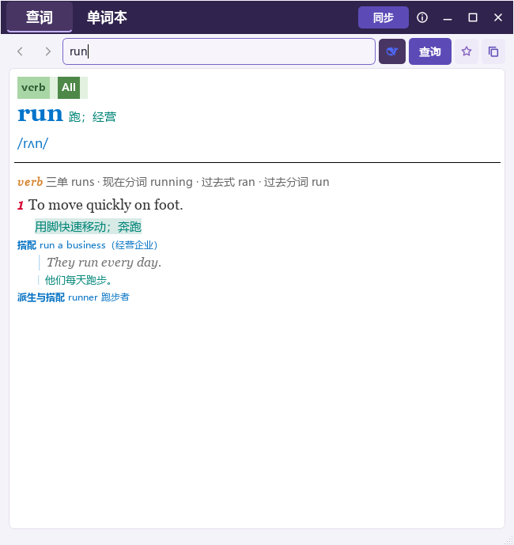
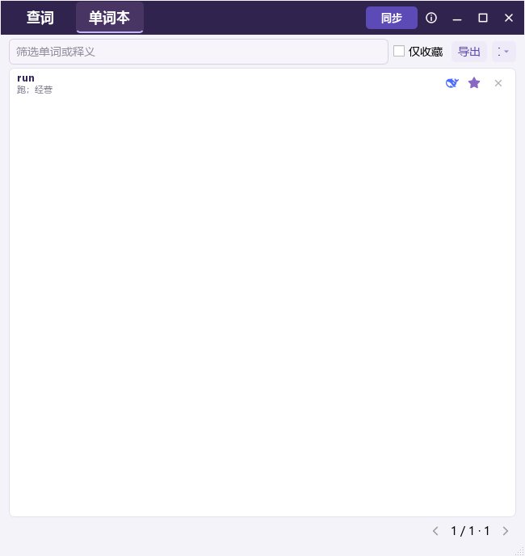

# 拾词 MyDict — C++ / Qt

以 C# / WPF **1.5.1** 为功能基线的 Qt Widgets 版本，C++17、Qt 6、CMake、Conda。作者 **Yance Feng & Codex**，应用源码 MIT 许可。保留逐义双语释义、DeepSeek、收藏/查询统一 SQLite、历史、分页、字体样式热更新、导入和 Gitee 同步。本次共享版本让 **C#、Windows Qt、macOS Qt、Linux Qt 通过同一 Gitee 词库双向共享**。

跨平台接入步骤、升级和格式约定见 [共享词库说明](docs/SHARED_WORDBOOK.md)，配置参考 [共享用户示例](configs/shared-user.example.json)。固定旧版 `v1.5.1` 不支持公共 JSON 载荷，参与共享的 C# 与 Qt 客户端都需要升级到本次共享版本。

## 界面预览

以下为 Qt 版合成测试词条的真实窗口截图，不含个人词库。

| 查词 | 单词本 |
| :---: | :---: |
|  |  |

## 编译和程序

| 平台 | 架构 | 本次验证 |
| --- | --- | --- |
| Windows 10/11 | x64 | VS2022 + Conda Qt6 本机编译、离线测试、脱离 Conda 启动验证 |
| Linux | x64 | Debian 12 / WSL + Conda Qt6 原生编译、离线测试、脱离 Conda 启动验证 |
| macOS | Apple Silicon arm64、Intel x64 | GitHub Actions 原生编译、离线测试、打包、脱离 Conda 启动验证 |

三平台自动构建入口：[GitHub Actions](https://github.com/hippo-yf/MyDict/actions/workflows/qt-build.yml)。每个成功任务提供程序压缩包、SHA256 和测试结果。不同平台的二进制由对应平台编译，macOS 的两个架构分别打包。

本地编译目录是 `build/windows`、`build/linux`；便携包位于 `dist/`。`MyDictQt` 是 GUI，`MyDictTool` 是命令行导入/维护工具。开发目录内先前复制的 C# 文件保留在本机，Qt 的 CMake 只编译 `src/` 中的 C++，不编译这些 C# 文件。

## 建立 Conda 环境

```sh
conda env create -f environment.yml
conda activate mydict-qt
```

Windows 另需 VS2022 的“使用 C++ 的桌面开发”组件和 Windows SDK。macOS 另需 Xcode Command Line Tools (`xcode-select --install`)。Linux 可使用 Conda 编译器：

```sh
conda install -c conda-forge cxx-compiler patchelf
```

Windows：

```powershell
.\build-qt.ps1
# 已有 Qt Conda 环境可直接复用：
.\build-qt.ps1 -QtPrefix C:\path\to\conda\envs\mydict-qt -Package
```

macOS / Linux：

```sh
bash build-qt.sh
python tools/package-qt.py --build build/darwin --prefix "$CONDA_PREFIX"
# Linux 的默认构建目录是 build/linux
```

直接使用 CMake：

```sh
cmake -S . -B build/native -G Ninja -DCMAKE_BUILD_TYPE=Release -DCMAKE_PREFIX_PATH="$CONDA_PREFIX" -DBUILD_TESTING=ON
cmake --build build/native --parallel 4
QT_QPA_PLATFORM=offscreen ctest --test-dir build/native --output-on-failure
```

Windows 的 `CMAKE_PREFIX_PATH` 使用 Conda 环境下的 `Library`，生成器使用 `Visual Studio 17 2022` 和 `-A x64`。源码兼容 Qt5.15 / Qt6 的公共 API，但本次实际构建和发布使用 Qt6。

## 操作规则

- 深紫色顶栏、查词/单词本两个完整页面，无设置按钮。支持窗口拖动、边缘缩放、最小化、最大化及窗口位置恢复。
- 自动识别中英文。普通在线查询在输入停止后防抖触发；DeepSeek 模式下输入只读缓存，点击查询、回车或点击未缓存的释义单词才联网。已有 DeepSeek 释义时，手动重新查询先确认；取消保持原内容。
- DeepSeek 鲸鱼图标蓝色代表开启，白色代表关闭，点击显示三秒状态提示。查询按钮会更新结果。Alt+左右键跳转历史；Ctrl+R 在 DeepSeek 模式下不发起付费调用。
- 逐个含义显示对应中文、双语例句、音标、词形、派生及双语搭配；例句和解释使用语法分段颜色、粗体及斜体。英文词 hover 下划线，点击继续查词。词性标签可过滤，All 显示全部。隐藏旧 AI 提示、来源/模型/时间长文字和例句“句法”说明。
- 查词星标可以收藏和取消收藏。单词本每页只读取 50 条摘要与来源元数据，点击词条再读取完整释义。右侧最多两个来源图标（DeepSeek、普通在线），和星标/X 垂直居中。
- X 只移除未收藏词；收藏词必须先取消收藏，数据库事务同样阻止直接删除。删除包含全部来源和历史，保留同步删除标记，防止旧快照复活。
- 摘要优先 DeepSeek，完整正文按最新查询时间选择（同时间 AI 优先），与 1.5.1 保持一致。
- Ctrl+加号/减号调整解释与单词本字号，Ctrl+[ / ] 调整行距。设置保存到 `settings.json`，外部修改后热更新。字体优先从 `fonts/` 按名称匹配，再由系统匹配。

字体目录只索引 OpenType 名称元数据，不会注册全部附带字体。Qt 仅注册当前界面、正文、英文词头所需的本地字体族及其粗体、斜体变体；当前词条有音标时才加入音标字体。修改字体设置或切换词条后重新计算所需字体，取消不再使用的本地字体注册。仅当界面或正文经过系统回退仍缺少常用中文字形时，才加载附带的 Noto Sans SC。未被使用的 Nerd Font、Noto、其他 `fonts/` 文件和 C# 专用字体设置均不会导致提前加载。此策略不改变 Qt 的系统字体渲染后端。
- 在线 HTTP 及解析在独立 QThread；SQLite、分页、迁移、导出和同步在后台执行。启动先显示界面，完整释义按需载入。

## 设置和数据目录

程序首次启动生成 `settings.json`。示例见 [`settings.qt.example.json`](settings.qt.example.json)，每组带中文说明。默认 `username` 留空以隔离不同设备，`CacheSync` 和 DeepSeek 默认关闭，密钥为空；普通来源支持 MyMemory、LibreTranslate、Free Dictionary API 和 Wiktionary。

共享时，同一个人在 C# 和三平台 Qt 的本地设置中手动填写**相同的 `username` 和 `CacheSync.Repository`**，各设备保留独立的 `DeviceId`、SSH 路径及 API 密钥。`username` 是词库身份，不是 Gitee 登录名；留空生成的本机身份不能保证跨设备相同。不要复制整份真实设置，也不要把示例中的 `your-user` 作为所有人的默认身份。

```json
{
  "DeepSeek": {
    "Enabled": false,
    "ApiKey": "在此填写自己的密钥",
    "Endpoint": "https://api.deepseek.com/chat/completions",
    "Model": "deepseek-flash",
    "TimeoutSeconds": 90,
    "MaxTokens": 8192
  }
}
```

模型名称由用户按服务提供方实际支持情况配置。测试不使用真实 API Key，也不会消耗付费额度。旧 Windows `ProtectedApiKey` 不可跨平台解密，请在 Qt 配置中重新填写 `ApiKey`。

Windows 默认在程序旁保存；macOS / Linux 默认在 Qt 的系统用户数据目录（通常 `~/Library/Application Support/hippo-yf/MyDictQt`、`~/.local/share/hippo-yf/MyDictQt`）。所有平台均可指定：

```sh
MyDictQt --data-dir /path/to/mydict-data
MyDictTool --data-dir /path/to/mydict-data --check
```

词库统一为：

```text
<data-dir>/profiles/<username>/words-shared.sqlite
```

单个 SQLite 文件保存所有来源、收藏、历史、删除事件和导入错误。分页不解码 BLOB。C# 与 Qt 的公共载荷使用 `MYDICT-JSON1` 加换行作为前缀，随后是 UTF-8 JSON，字段采用相同的 PascalCase；数据库 `payload_format` 为 `mydict-json-v1`。JSON 仍保存在 SQLite BLOB 中，不生成独立 JSON 查询缓存。

旧本地 `words-qt.sqlite`、C# 的 `words.sqlite` 和远端旧快照均保留。Qt 启动显示窗口后，在后台只读导入旧 Qt 库；新版 C# 可读取旧二进制 XML、旧 Qt JSON 和公共 JSON，并把旧内容转换为公共快照。Qt 不尝试解析旧 .NET 二进制 XML，需要由新版 C# 完成这一步转换。历史和导入错误属于本地状态，不在设备间合并。

## 接入现有 C# 和 Qt 词库

日常跨平台共享不再需要手动导出文件：

1. 在持有旧 C# 词库的 Windows 设备上升级为本次共享版本，保留原 `settings.json`、`profiles/` 和旧 SQLite。先确认 `username` 是自己要共用的身份。
2. 使用新版 C# 点击“同步”，它会读取旧本地及旧远端二进制快照，并发布公共 JSON 快照。原文件保留。C# 共享版的编译和部署入口见 [仓库 README](../README.md)。
3. 在 Windows/macOS/Linux Qt 中填写相同 `username` 和仓库地址，各自配置本机 SSH 权限，启用 `CacheSync` 后点击“同步”。三平台即可读取这些公共释义、收藏和删除状态；新的查询和变更也会同步回 C#。
4. 已使用 Qt 版的设备会在后台导入本机旧 Qt 库；同步时兼容读取 `qt-users/<username>/` 的旧 Qt 快照，并发布到公共目录，无需删除旧文件。

如果只有旧 C# 数据的离线副本，或者暂时不能运行新版 C#，仍可使用可选的只读导出工具。在 Windows 根仓库中执行：

```powershell
.\Cpp-QT\tools\Export-Legacy.ps1 -SourceDatabase '原路径\profiles\用户名\words.sqlite' -OutputFile '新路径\mydict-migration.ndjson'
```

该工具使用原 `MyDict.exe` 中的 DTO 解码，在只读事务中逐条导出。可用 `-LegacyExe` 指定旧程序。原库不改写；导出文件包含全部来源、收藏/取消收藏事件、删除标记、历史和导入错误，应像个人词库一样保密。

Qt 目标配置 `username` 应与源库相同，再执行：

```sh
MyDictTool --data-dir /path/to/qt-data --import-json /path/to/mydict-migration.ndjson --check
```

也可在单词本的“⋯”菜单选择迁移文件。导入为一个事务，错误回滚，重复导入幂等。此方式用于离线搬运；启用公共同步后无需为每次设备间交换重复导出。

## 导入编号单词本

```sh
MyDictTool --data-dir /path/to/data --import-wordbook /path/to/1.txt --dry-run
MyDictTool --data-dir /path/to/data --import-wordbook /path/to/1.txt --concurrency 4 --delay-ms 1500 --retries 2
```

输入格式为 `1, word [音标] 英译中`，自动规范化去重。并发范围 1–32，请求启动间隔全局共享。已有 DeepSeek 结果直接复用；`--force-refresh` 才重新付费查询。可用 `--limit 5` 先处理少量。每个成功结果立即保存并收藏，错误写入 SQLite；重复执行可续传。执行时必须关闭正在使用同一词库的 GUI。退出码 0 成功、2 部分失败、1 停止/配置错误。

CSV 导出支持筛选后的单词本界面导出，或：

```sh
MyDictTool --data-dir /path/to/data --export-csv /path/to/words.csv --favorites-only
```

## Gitee 同步

`CacheSync` 默认关闭，配置自己的 Git/SSH 权限后启用。手动顶部“同步”可立即执行。启动自动只拉取；本地内容变更约 30 分钟后批量同步；关闭取消网络，不丢已提交本地事务。

公共快照位置统一为：

```text
users/<username>/shared/cs-<device-hash>.sqlite
users/<username>/shared/qt-<device-hash>.sqlite
```

C# 与 Qt 每个客户端写自己的分片，并按来源查询时间、收藏事件及删除标记合并其他分片。这里的 `cs`/`qt` 只区分写入客户端，公共数据格式相同；无需为每个平台创建独立词库。旧 `users/<username>/*.sqlite` 和 `qt-users/<username>/*.sqlite` 保留为兼容读取来源，不会因升级被删除或原地覆盖。

共享身份相同才会交换数据，不共享 API Key、SSH 私钥、`settings.json`、字体或窗口状态。不生成 JSON 快照。具体配置和升级检查见 [共享词库说明](docs/SHARED_WORDBOOK.md)。固定旧版 1.5.1 不读取公共 JSON，应升级后再参与新的双向共享。

## 测试与代码入口

`src/core.*` 存储/配置；`services.*` 在线协议/解析；`mainwindow.*` 窗口异步协调；`entryrenderer.*` 富文本；`sync.*` Git/SSH；`importer.*` 有界批量导入。`tests/*_test.cpp` 覆盖 SQLite/时间精度/删除冲突、DeepSeek 格式纠正和取消、普通来源逐义翻译、UI 交互、离线 Git 同步及导入。

`tools/smoke-package.py` 用临时数据清除 Conda 路径后验证便携包。C#→Qt 小型迁移 fixture 已验证原库 SHA256 不变，重复导入不重复记录。所有自动测试使用合成数据或 mock HTTP，不查询真实个人词库。

跨平台系统字体、窗口管理和抗锯齿会有差异；不随包分发 Windows 专有字体。macOS 包使用临时签名，不包含 Apple Developer 公证；首次运行的系统处理取决于用户的 macOS 安全设置。

许可详见 `LICENSE`、`QT-NOTICES.md` 与包中的 `third-party-licenses`。不要发布 `settings.json`、个人 SQLite、迁移文件、`fonts/local/` 或 SSH 私钥。
