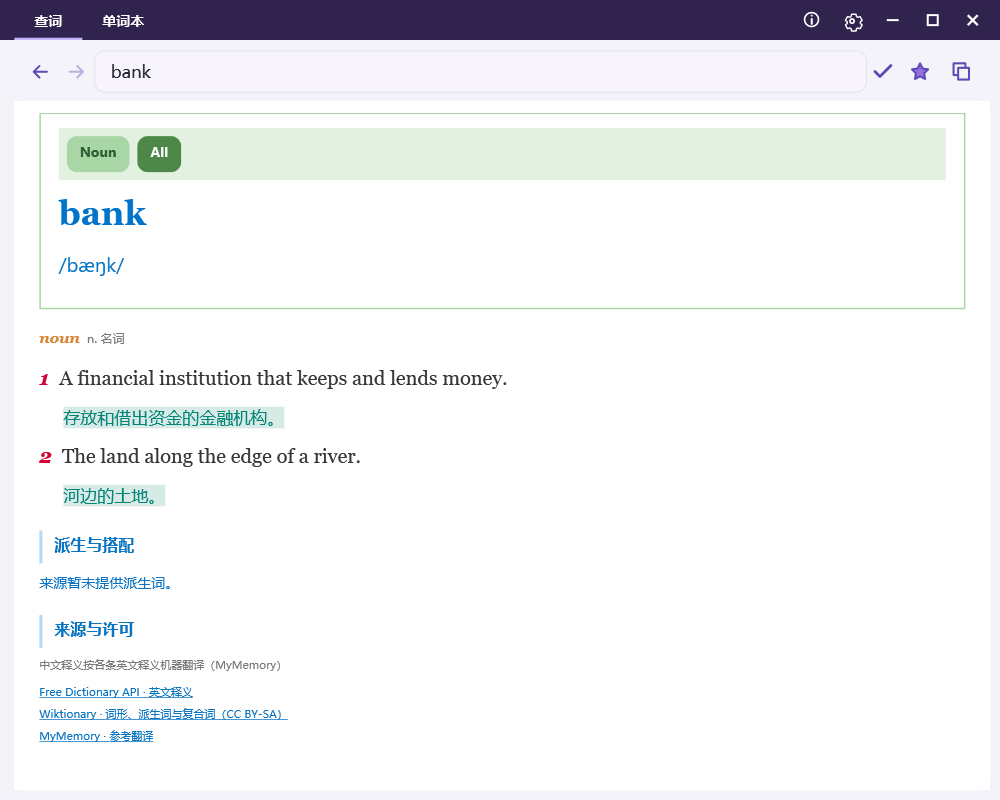

# 拾词 · MyDict

简洁的 Windows 中英词典，使用 C# / WPF 开发。

**稳定版：v1.3.0** · 作者：Yance Feng & Codex · [MIT License](LICENSE)

## 功能

- 自动识别中英文，输入停顿后自动查询。
- 音标、按词性分组的释义、例句、同反义词、派生与词形。
- 每条英文释义下显示对应的中文机器翻译。
- 悬停英文单词显示下划线，点击可继续查词。
- 本地缓存优先，前进/后退查看历史，重启恢复上次记录。
- 单词本支持收藏、取消收藏、筛选与 CSV 导出。
- 单一 JSON 配置：样式按用途分为 7 组，字段附中文说明，保存后自动重载。
- 窗口大小、位置及最大化状态自动恢复。



## 运行

下载 GitHub Releases 中的 `MyDict-v1.3.0-win.zip`，解压到可写目录，运行 `MyDict.exe`。

需要 Windows 和 .NET Framework 4.8。无需安装额外 NuGet 组件。首次启动会在程序目录创建默认配置。

| 操作 | 用法 |
| --- | --- |
| 查询 | 输入文字，默认停顿 650 毫秒后自动查询 |
| 连续查词 | 点击释义或例句中的英文单词 |
| 历史 | 输入框左侧箭头，或 Alt+Left / Alt+Right |
| 更新结果 | Ctrl+R 跳过缓存重新联网查询 |
| 收藏 | 星标切换；单词本支持“只看收藏” |
| 设置 | 顶部齿轮打开程序目录的 settings.json |

## 设置与数据

- `settings.json`：功能设置、`Window` 窗口状态和分组 `Styles`。`_说明` 为中文字段说明，不参与配置。
- `lookup-cache.json`：已查结果、历史及当前位置；命中缓存时无需联网。
- `%LOCALAPPDATA%\MyDict\favorites.json`：收藏的单词与完整释义。

配置和缓存更新保留 `.bak`。旧版 YAML 样式可在首次升级时自动合并到 JSON，原文件保留。非法配置不会替换当前有效设置。

可参考 [settings.example.json](settings.example.json)。常用样式：

- `Styles → 02_单词本 → number.book.word_size`：单词本字号。
- `Styles → 03_词条与释义 → font.doc.serif`：英文释义字体。
- `Styles → 03_词条与释义 → number.doc.scale`：解释区整体缩放。

实际发布包不含开发者个人设置、密钥、查词缓存或收藏。

## 在线服务

基础翻译及逐条中文释义使用 [MyMemory](https://mymemory.translated.net/doc/spec.php)，也可自行配置 [LibreTranslate](https://docs.libretranslate.com/guides/api_usage/)。MyMemory 匿名使用有每日额度，逐条中文释义会消耗额度。服务不可用时保留已取得的英文及缓存内容。

英文资料来自 [Free Dictionary API](https://dictionaryapi.dev/)；词形及派生词来自 [Wiktionary](https://en.wiktionary.org/)。缺失资料不会根据拼写猜测。中文释义为英文分义的机器翻译，可能存在不准确的情况。

在线查询会将输入与英文释义发送到所选服务。手动填写 `ApiKey` 后该字段为明文；旧版 `ProtectedApiKey` 使用 Windows 当前用户加密。不要将个人配置上传到公开仓库。

## 使用 VS2022 编译

安装 Visual Studio 2022 的“.NET 桌面开发”工作负载和 .NET Framework 4.8 开发工具，打开 `MyDict.sln`，选择 Release 编译。

也可在 PowerShell 运行：

```powershell
.\build.ps1
```

输出为 `bin\Unified\MyDict.exe`。运行离线核心检查：

```powershell
.\tools\Test-Release.ps1
```

生成不含个人数据的便携发布包：

```powershell
.\tools\Package-Release.ps1
```

## 许可

应用源码使用 [MIT](LICENSE)。第三方在线词典内容不随发布包分发，也不适用本项目的 MIT 许可；来源与许可链接显示在词条底部。详见 [THIRD-PARTY-NOTICES.md](THIRD-PARTY-NOTICES.md)。
