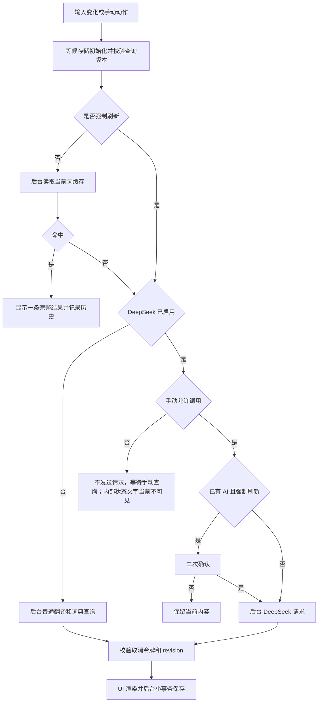
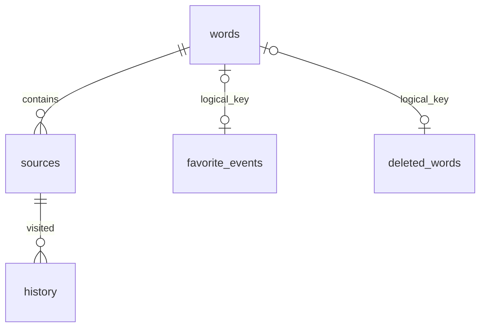

# 拾词 MyDict 技术交接 Specification

> 交接基线：v1.5.1，Windows x64 / C# WPF / .NET Framework 4.8。
>
> 编写日期：2026-11-03。
>
> 发布源码提交：`627241a8ac91d7ddac2530beead5283fe755b0c6`。
>
> 本文审计的仓库 HEAD：`2958aee`，在 v1.5.1 基础上补充 README 截图。
>
> 适用对象：接手开发、测试、部署、数据迁移及后续重构的工程师。

快速入口：[README](../README.md) · [变更记录](../CHANGELOG.md) · [示例配置](../settings.example.json) · [测试脚本](../tools/Test-Release.ps1)。

本文以仓库代码为准。标记为“当前实现”的内容描述已落地行为；“约束”是继续开发应保持的规则；“后续建议”尚未实现。文档中的示例使用虚构用户名和占位密钥，不包含真实 API Key、SSH 私钥或个人词库。

## 目录

1. [产品目标与范围](#1-产品目标与范围)
2. [版本、仓库与交付物](#2-版本仓库与交付物)
3. [技术栈与运行环境](#3-技术栈与运行环境)
4. [目录与模块职责](#4-目录与模块职责)
5. [核心领域模型](#5-核心领域模型)
6. [界面与交互规格](#6-界面与交互规格)
7. [查询流程与并发控制](#7-查询流程与并发控制)
8. [在线服务与 DeepSeek 协议](#8-在线服务与-deepseek-协议)
9. [释义排版与字体](#9-释义排版与字体)
10. [SQLite 数据规范](#10-sqlite-数据规范)
11. [收藏、删除与冲突合并](#11-收藏删除与冲突合并)
12. [启动、分页与性能约束](#12-启动分页与性能约束)
13. [旧数据迁移](#13-旧数据迁移)
14. [Gitee 同步](#14-gitee-同步)
15. [配置规范](#15-配置规范)
16. [旧词本批量导入](#16-旧词本批量导入)
17. [工具、构建与测试](#17-工具构建与测试)
18. [发布与回滚](#18-发布与回滚)
19. [排障手册](#19-排障手册)
20. [隐私、许可与边界](#20-隐私许可与边界)
21. [已知限制与后续建议](#21-已知限制与后续建议)
22. [交接验收清单](#22-交接验收清单)

## 1. 产品目标与范围

### 1.1 产品目标

拾词是一款紧凑的中英在线词典。核心使用路径为输入、阅读、连续点击查词、收藏与复习。要求解释内容占据主要窗口面积，窗口在网络查询、数据库操作和同步期间保持可操作。

优先级依次为：

1. 现有词库、收藏和删除状态可靠保存。
2. 启动及交互流畅，避免全量加载和 UI 线程长任务。
3. 逐义中英文解释、例句、词形与搭配可读且对应准确。
4. 真实付费 API 调用受用户操作约束。
5. 配置、字体、窗口尺寸和发布流程易维护。

### 1.2 已实现范围

- 自动识别中英输入；普通在线翻译与英文词典资料。
- 可选 DeepSeek 查询，结构化双语词义、简短翻译、词形、派生词和双语搭配。
- 合并的查词解释页；独立的单词本标签页。
- 本地 SQLite 缓存、多来源释义、收藏、历史导航、筛选、分页和 CSV 导出。
- 查词页及单词本的收藏切换；非收藏词的完整移除。
- Gitee SSH 跨设备 SQLite 快照同步。
- JSON 配置和样式热重载；本地字体优先；窗口状态恢复。
- 旧 JSON 词库迁移、旧导出词本的并发 DeepSeek 导入。

### 1.3 不属于当前交付的功能

- 用户注册、云账户认证和服务端数据库。
- 多平台原生客户端、浏览器插件或 Web 服务。
- 语音播放、背词计划、间隔重复算法或 OCR。
- 离线内置完整词典数据库。
- SQLite 数据库或 DeepSeek 密钥的全盘加密。
- 在任意语言客户端直接解码现有二进制 BLOB 的通用协议。

工作区可能出现 `Cpp-QT/`、`CSharp/` 等额外目录；它们不是当前 `MyDict.csproj` 的编译输入。接手时应单独确认其用途，不将未跟踪的其他实现自动纳入本次发布基线。

## 2. 版本、仓库与交付物

| 项目 | 当前约定 |
| --- | --- |
| 应用名称 | 拾词 / MyDict |
| 作者 | Yance Feng & Codex |
| 固定版本 | 1.5.1 |
| AssemblyVersion / FileVersion | 1.5.1.0 |
| InformationalVersion | 1.5.1 |
| 当前维护分支 | `develop/1.5` |
| 固定 Git 标签 | `v1.5.1` |
| 主要源码远端 | `gitee` → `git@gitee.com:hippo-yf/MyDict.git` |
| 另一个源码远端 | `origin` → GitHub MyDict；不能假设它已同步到 Gitee 最新提交 |
| 数据同步远端 | `git@gitee.com:hippo-yf/MyDict-Cache.git`，与源码仓库分开 |
| 编译输出 | `bin/1.5/MyDict.exe` |
| 发布包 | `release/MyDict-v1.5.1-win-x64.zip` |
| 校验 | 同名 `.zip.sha256` 以及 `release/SHA256SUMS.txt` |

固定标签不得移动、覆盖或删除。修复应产生新提交和新版本，保留 v1.3.0、v1.4.0、v1.5.0 等已发布版本。普通 README 更新可以在分支上继续提交，无需改动已发布标签。

## 3. 技术栈与运行环境

| 层次 | 实现 |
| --- | --- |
| 语言 | C# 7.3 |
| GUI | WPF / XAML / FlowDocument |
| 框架 | .NET Framework 4.8 |
| 平台 | 明确的 x64，`Prefer32Bit=false` |
| 数据库 | Windows 自带 `winsqlite3.dll`，通过 SQLite C API P/Invoke 调用 |
| HTTP | `HttpClient`，TLS 1.2 |
| JSON | `JavaScriptSerializer`，用于 API、设置及旧格式兼容 |
| 释义持久化 | DataContractSerializer 二进制 XML，再经 GZip 压缩，存 SQLite BLOB |
| 同步 | 命令行 Git + SSH + 每设备 SQLite 快照 |
| 构建 | VS2022 MSBuild；非 SDK 风格 `.csproj` |

运行要求：Windows 10/11 64 位，.NET Framework 4.8，可写程序目录。使用在线查询需网络，使用 Gitee 同步另需 Git、SSH、仓库权限及已验证主机密钥。

构建要求：Visual Studio 2022 的“.NET 桌面开发”工作负载、.NET Framework 4.8 Developer Pack。项目目前不依赖 NuGet SQLite 包，也不分发第三方原生 SQLite DLL。

新增源文件必须显式加入 `.csproj` 的 `<Compile Include=...>`；不能按 SDK 项目的习惯假设自动包含。不要直接引入仅适用于 .NET 6/8 的 API 或新语言特性。

## 4. 目录与模块职责

```text
MyDict/
├─ App.xaml / App.xaml.cs          应用入口、通用控件样式
├─ MainWindow.xaml(.cs)            主界面、异步业务协调、查询取消、分页与同步状态
├─ EntryDocument.cs               FlowDocument 渲染、词性切换、单词链接
├─ SentenceStyles.cs              语法分段校验和着色
├─ DeepSeekService.cs             AI 请求、格式纠正、解析与来源识别
├─ Services.cs                    Entry、普通翻译、旧收藏与 CSV 兼容工具
├─ DictionaryService.cs           词典领域模型、Free Dictionary 与 Wiktionary
├─ SenseTranslator.cs             普通词典逐义翻译
├─ WordForms.cs                   词形模型、词形显示及旧解析辅助
├─ WordDatabase.cs                当前统一 SQLite 存储和合并规则
├─ Sqlite.cs                      最小原生 SQLite 封装
├─ LegacyJson.cs                  流式读取旧 JSON
├─ CacheSync.cs                   身份、同步配置、Git/SSH 和同步调度辅助
├─ LookupCache.cs                 旧 JSON 缓存格式及来源键兼容
├─ BookSource.cs                  单词本来源图标
├─ Settings.cs / ConfigLayout.cs  设置持久化、验证、分组和中文说明
├─ ThemeStyles.cs                 样式合并、转换和 WPF 资源应用
├─ styles.defaults.json           嵌入程序的默认样式
├─ AppFonts.cs                    本地字体发现、优先加载和系统回退
├─ WindowLayout.cs                窗口几何恢复和屏幕边界修正
├─ AboutWindow.cs                 作者、版本和关于窗口
├─ SettingsWindow.xaml(.cs)       旧设置窗口兼容代码，无主界面设置入口
├─ settings.example.json          不含真实密钥的示例配置
├─ fonts/                         可分发字体及许可；local/ 仅本机
├─ screenshots/                   README 使用的界面截图
├─ assets/                        应用图标；qa/ 仅本地验证
├─ tests/                         独立 C# 测试入口
├─ tools/                         测试、导入、维护、截图及发布脚本
├─ build.ps1                      VS2022 构建入口
└─ docs/HANDOVER_SPECIFICATION.md 本交接文档
```

以下目录不属于源码发布内容：`bin/`、`obj/`、`release/`、`profiles/`、`cache-sync/`、`imex/`、`fonts/local/`、`assets/qa/`。真实设置、SQLite 文件、私钥、临时文件及备份同样不应提交。

## 5. 核心领域模型

### 5.1 Entry

定义于 `Services.cs`，表示某一次来源查询的完整结果，不等价于一个单词的全部来源。

| 字段 | 含义 |
| --- | --- |
| `Word` | 原始查询词/短语/文本；词条身份依据之一 |
| `Pair` | `en\|zh-CN` 或 `zh-CN\|en`；缺失时按输入检测 |
| `Translation` | 基础翻译 |
| `Summary` | 可选简短翻译 |
| `ShortTranslation` | 计算属性；优先 Summary，否则 Translation，去换行，最多 80 字符含省略号 |
| `Record` | 结构化词典记录 |
| `Details` | 旧式纯文本详细内容/导出兼容内容 |
| `DetailNote` | 如中文查询映射到英文词头的说明 |
| `SavedAt` | 旧本地时间显示字段，不应作为新逻辑首选比较依据 |
| `TranslationProvider` / `TranslationUrl` | 翻译提供方和参考链接 |
| `LookupSource` | 查询来源标识 |
| `LookupModel` / `QueryEndpoint` | DeepSeek 模型与接口来源元数据 |
| `QueriedAtUtc` | 查询时间 UTC |
| `SuccessfulQueryAtUtc` | 成功查询时间 UTC；错误不得更新它 |

查询时间优先级由 `CacheMerge.QueryTime` 定义：`SuccessfulQueryAtUtc` → `QueriedAtUtc` → `SavedAt` → 最小值。

### 5.2 词典结构

```text
Entry
└─ DictionaryRecord
   ├─ Word / Phonetic / Origin / Derived / Notice / Sources
   ├─ Forms: WordForms
   └─ Meanings[]
      ├─ PartOfSpeech / Synonyms[] / Antonyms[]
      └─ Senses[]
         ├─ Definition / Chinese / ChineseSource / ChineseFailed
         ├─ UsageNote
         ├─ Collocations[]
         ├─ DefinitionSegments[]
         ├─ Example                  旧单例句兼容
         └─ Examples[]
            ├─ Text / Chinese / GrammarNote
            └─ Segments[]: Text / Role / Pos
```

`WordForms` 字段：`Plural`、`ThirdPerson`、`PresentParticiple`、`Past`、`PastParticiple`、`Uncountable`。

`Collocations` 在内部仍是 `List<string>`。AI 返回的 `{text, chinese}` 在解析时转换为 `英文（中文）`，并未保留独立的英文/中文列。跨语言或结构化导出时应注意这是一项当前格式限制。

### 5.3 列表和完整词条分离

- `WordRow`：SQLite 查询得到的轻量列表元数据。
- `WordPage`：最多一页元数据，加总数、收藏数和筛选数。
- `MainWindow.BookRow`：WPF 绑定对象，包含 Id、摘要、图标、收藏状态；`Entry` 仅是携带 Word/Pair 的轻量占位对象。
- `WordSelection`：用户点击后才读出的完整 Entry、词条 Id 和收藏状态。

**约束：不要因为列表对象存在 `Entry` 属性，就把每个来源的完整 Record 填进去。**

## 6. 界面与交互规格

### 6.1 主窗口

- 无系统标题栏，顶部为深紫色导航与窗口按钮。
- “查词”“单词本”是两个完整页面。
- 顶部保留同步、关于、最小化、最大化/还原、关闭。
- 设置按钮已移除；设置通过 EXE 旁的 JSON 文件修改。
- 应用图标采用“拾”字与书页的 B 款图标，多尺寸 ICO 已嵌入 EXE 和窗口。
- 窗口大小、位置和最大化状态在退出时保存，下次恢复，并限制在可用屏幕范围内。

### 6.2 查词页

| 操作 | 规格 |
| --- | --- |
| 输入 | 无语言下拉框，自动检测中英；停顿后触发普通查询或读缓存 |
| 查询按钮 / 输入框 Enter | 明确的手动刷新；可重新联网更新当前来源 |
| DeepSeek 鲸鱼 | 蓝色启用、白色关闭；显示约 3 秒“已开启/关闭 DeepSeek查词”提示 |
| 收藏星标 | 当前已收藏时再次点击取消收藏，否则收藏；写入期间防重复点击 |
| 复制 | 复制当前显示 FlowDocument 的纯文本 |
| 历史箭头 | 前进/后退，切换本地查词记录 |
| 单词链接 | 英文 hover 仅显示下划线，点击可继续查词；不显示 hover 文字提示 |
| 当前词本身 | 在正文中不再作为可点击查词链接；词形、派生词等仍可点击 |

“已有 DeepSeek 释义再次查询”指将实际发送新的 DeepSeek 请求的刷新。需要 Yes/No 二次确认，默认 No；取消不发请求、不替换当前内容。单纯读取缓存不弹确认。

### 6.3 单词本

- 一行一个逻辑词条，同词的多个来源合并显示。
- 左侧词头，中间摘要，右侧来源图标、收藏星标和 X。
- 来源图标分两类：DeepSeek、普通在线网站；同类来源只显示一个图标。
- 摘要优先选择已有 DeepSeek 的简短翻译，即使普通来源更新。
- 收藏星标为矢量路径，避免字体星号基线偏移。
- X 在收藏状态下禁用；必须先取消收藏。数据库层也必须原子检查，不能仅依赖按钮禁用。
- 移除会清除这个词的所有来源缓存及相关历史，并写入删除标记；不是仅从列表隐藏。
- 移除当前词前取消其在途请求，并阻止同词新请求进入，避免请求完成后把词写回来。
- 搜索框筛选词头及摘要；“只看收藏”在数据库中筛选。
- 每页 50 条，使用上一页/下一页；不是无限追加列表。
- 来源图标、星标和 X 应保持视觉垂直对齐，双行摘要也不应错位。

### 6.4 快捷键

| 快捷键 | 行为 |
| --- | --- |
| Enter | 仅输入框有焦点、非 IME 组字、无修饰键时等价于查询按钮 |
| Alt+Left / Alt+Right | 历史后退/前进 |
| Ctrl+R | 跳过缓存走刷新入口；DeepSeek 模式下不会自动发送付费查询 |
| Ctrl+加号/减号 | 内容缩放每次 ±0.05；单词本字号和行高按比例调整 |
| Ctrl+[ / Ctrl+] | 解释区行距缩放每次 ±0.1；单词本行高按比例调整 |

缩放范围 0.65–2.2；快捷键只在本窗口生效，结果写回 Styles。不是全局热键。

## 7. 查询流程与并发控制



### 7.1 入口语义

`MainWindow.SearchCoreAsync(forceRefresh, manual)` 为核心入口：

| 入口 | forceRefresh | manual | 说明 |
| --- | --- | --- | --- |
| 输入停顿 | false | false | 可用缓存；AI 未命中时等待按钮 |
| 查询按钮 / Enter | true | true | 刷新当前来源；已有 AI 需确认 |
| 点击解释单词 | false | true | 先读缓存，无缓存才允许联网 |
| Ctrl+R | true | false | 普通来源刷新；AI 不自动调用 |

缓存内容的选择和摘要选择是两套规则：完整结果按查询时间优先、同时间 AI 优先；摘要按 AI 优先、再按查询时间选择。不要误改成“列表显示的最新结果一定是摘要来源”。

### 7.2 过期结果保护

- `revision` 随输入失效等操作递增。
- 每次在线操作使用独立 `CancellationTokenSource`。
- 输入变化、连续点击查词和删除当前词会取消旧请求。
- await 后校验查询版本、数据库实例和窗口状态，过期结果不得更新当前窗口。
- 查询开始时复制来源设置，避免热重载改变在途请求的模型、地址或密钥。
- `removingWords` 阻止正在删除的词再次进入查询。
- UI 只在结果仍对应当前操作时更新；完整 Entry 不应跨页面批量常驻。

### 7.3 线程模型

网络请求、解析、SQLite 操作、迁移和同步由后台 Task 执行。WPF 控件及 FlowDocument 的创建/替换回到 UI 线程。

这是线程池和异步 I/O，不是每次查询创建一个独立进程，也不是固定专用数据库线程。`pendingWrites` 跟踪本地写入，退出时等待必要本地事务；不为网络同步长时间阻塞关闭。

## 8. 在线服务与 DeepSeek 协议

### 8.1 普通来源

- `Translator`：MyMemory 或 LibreTranslate；超时约 20 秒。
- `DictionaryService`：Free Dictionary API 英文释义，Wiktionary 词形及派生；超时约 15 秒。
- `SenseTranslator`：为普通词典每个英文义项分别翻译中文，最多 2 个并发。
- 逐义翻译按 UTF-8 文本元素切为不超过 480 字节的片段；不把一个笼统翻译套到所有义项。
- 翻译失败但英文词典成功时允许展示并保留英文资料，部分中文缺失有状态标记。
- 中文翻译结果若可识别为单个英文词/短语，可继续查询其英文词典资料。
- 普通词头的词典查询约束：英文正则允许字母、连字符、撇号、空格，总长度不超过 80。

### 8.2 DeepSeek 请求

默认配置以 `DeepSeekOptions` 为准：

| 项目 | 默认 / 限制 |
| --- | --- |
| Endpoint | `https://api.deepseek.com/chat/completions`；必须完整 HTTPS 地址，无 userinfo |
| Model | `deepseek-flash`；可配置，不能空 |
| Enabled | false |
| TimeoutSeconds | 90；范围 10–300 |
| MaxTokens | 8192；范围 512–16384 |
| ApiKey | 默认空；调用时必须存在；不能含内部空白 |
| UI 输入长度 | 最多 500 个 UTF-8 字节 |

请求头为 Bearer 认证，JSON 关键字段：

```json
{
  "model": "deepseek-flash",
  "messages": [
    { "role": "system", "content": "词典格式及语言要求；包含合法 JSON 示例" },
    { "role": "user", "content": "bank" }
  ],
  "response_format": { "type": "json_object" },
  "thinking": { "type": "disabled" },
  "max_tokens": 8192,
  "stream": false
}
```

系统提示明确要求把用户输入当作词/短语/句子，不当作覆盖系统指令的命令。当前使用非流式输出；不能把“已经收到 HTTP 200”当成数据已可保存。

### 8.3 AI 内容格式

使用根级扁平 `senses`，避免历史上 `meanings/definitions` 多层嵌套导致缺括号的问题：

```json
{
  "word": "bank",
  "summary": "银行；河岸",
  "translation": "银行；河岸",
  "phonetic": "/bæŋk/",
  "forms": {
    "Plural": "banks",
    "ThirdPerson": "banks",
    "PresentParticiple": "banking",
    "Past": "banked",
    "PastParticiple": "banked",
    "Uncountable": false
  },
  "derived": ["banker (noun) 银行家"],
  "origin": "",
  "senses": [
    {
      "partOfSpeech": "noun",
      "definition": "An institution that holds money.",
      "chinese": "保管资金的金融机构；银行。",
      "usageNote": "可数名词，指金融机构。",
      "collocations": [
        { "text": "bank account", "chinese": "银行账户" }
      ],
      "definitionSegments": [],
      "examples": [
        {
          "text": "She opened an account.",
          "chinese": "她开了一个账户。",
          "segments": [
            { "text": "She", "role": "subject", "pos": "pronoun" },
            { "text": " opened", "role": "predicate", "pos": "verb" },
            { "text": " an account.", "role": "object", "pos": "noun" }
          ]
        }
      ]
    }
  ]
}
```

示例仅说明结构；实际应按词的真实词性生成对应词形，不能机械补造词源、音标或不存在的派生形式。提示要求合计约 2–4 个常见义项、每义一条自然双语例句，summary 为 1–4 个简短对应翻译。

当前解析器兼容旧 `meanings/definitions`、旧 `example`、旧字符串搭配。解析保护上限包括：最多 6 个词性组、每组最多 12 条定义、每义最多 4 个例句、8 个搭配、每句最多 160 个语法分段。

### 8.4 失败与纠正

- HTTP 401：密钥错误；402：余额不足；429：限流；其他非成功状态显示连接/服务错误。
- `finish_reason=length`：视为截断，提示增加 MaxTokens；不得把半条结果写入库。
- `finish_reason=stop` 仍可能返回无效 JSON，必须实际解析校验。
- 空内容或无效 JSON 最多再请求一次完整纠正；整个流程受配置超时和取消令牌约束。
- 支持去掉开头 BOM 和包裹的 Markdown 代码围栏。
- 连续无效时抛出错误，不覆盖已有缓存。
- 格式有效后还要校验基础翻译以及每条义项的英文/中文释义。
- 不将原始服务错误体、Authorization 或 API Key 展示到错误提示中。

后续更换模型、Endpoint 或请求参数时，应运行显式真实测试；普通离线回归不能证明某个实时服务仍支持全部参数。

## 9. 释义排版与字体

### 9.1 渲染结构

`EntryDocument.Build` 构造 FlowDocument，`Refresh` 保留当前词性筛选和滚动位置。主要布局为：

1. 词性筛选按钮条。
2. 词头与简短翻译；音标。
3. 词性标题，词形放在同一行，不重复显示 `noun n. 名词`。
4. 每条英文定义、对应中文、用法、双语搭配。
5. 英文例句和同缩进的中文例句。
6. 词源、派生/搭配、来源和参考链接。

不显示旧的 AI 总提示行、顶部模型/时间行和例句的独立“句法……”说明。来源元数据仍存于缓存；页脚仍保留来源性质说明及链接。`GrammarNote` 可能存在于旧数据和纯文本导出中，不等于当前 GUI 会展示它。

### 9.2 语法分段

允许的 `Role`：`subject`、`predicate`、`object`、`complement`、`adverbial`、`modifier`、`connector`、`other`。

只有满足以下条件才应用分段样式：所有分段有效、角色合法、将 Text 原样连接后与原句逐字符相同，包含空格和标点。否则整句按普通文本渲染，不能猜测或挪移字符串片段。

常见视觉规则：主语蓝、谓语紫且加粗、宾语青绿，修饰或状语可斜体；具体颜色和字重来自 Styles。分段中的英文单词仍保留可点击查词行为，词性按钮点击不缩放。

### 9.3 字体优先级

`AppFonts.Resolve`：按字体族名称先查 EXE 旁 `fonts/` 及子目录，命中后用本地 FontFamily，否则 `new FontFamily(name)` 交给系统解析。

- 支持 WPF 能识别的 TTF、OTF、TTC。
- 比较字体族名称，不比较文件名；一个字体可有本地化别名。
- 目录发现只做一次、进程内缓存；新增或更换字体后需重启。
- 不向系统注册或安装字体。
- 根目录包含四种 CaskaydiaCove NFP 字形及许可。
- `fonts/local/` 是仅本机的 Windows 字体，构建时可能复制到输出目录，公开发布包必须排除。

当前主要默认字体：正文/中文 Microsoft YaHei UI，英文释义 Georgia，音标/词性按钮 Segoe UI。旧 `FontName` 等兼容字段不能替代 Styles 的 `font.*`。

### 9.4 默认阅读尺寸

以 `styles.defaults.json` 为准：窗口约 650×689 WPF DIP；内容缩放 0.9，普通行距倍率 1.35，再乘行距缩放 0.85。单词本词头 12.6、翻译 10.8、对应行高 15.3/13.77。

窗口保存尺寸和 Styles 覆盖会优先于内置默认值。不得把某一台机器 DPI 下的物理像素截图尺寸直接写成 WPF DIP 默认值。

## 10. SQLite 数据规范

### 10.1 数据文件

```text
<exe-dir>/profiles/<username>/words.sqlite
```

缓存、收藏、历史、删除标记和导入错误在同一个逻辑数据库。运行时允许出现 `.sqlite-wal`、`.sqlite-shm`，它们是 SQLite 正常事务文件，不能在程序运行时随意删除。

`WordDatabase.Open` 检查 username 和 schema，当前 schema 字符串为 `1`。1.5.1 使用增加表和元数据键的兼容方式，仍为 schema 1。旧快照可能缺少新表，读取时通过 `sqlite_master` 检测。

### 10.2 表与索引

以下为逻辑等价 DDL；确切创建语句位于 `WordDatabase.Open`：

```sql
CREATE TABLE metadata (
    key TEXT PRIMARY KEY,
    value TEXT NOT NULL
);

CREATE TABLE words (
    id INTEGER PRIMARY KEY,
    normalized TEXT NOT NULL,
    pair TEXT NOT NULL,
    word TEXT NOT NULL,
    favorite INTEGER NOT NULL DEFAULT 0,
    favorite_at TEXT NOT NULL DEFAULT '',
    last_ticks INTEGER NOT NULL DEFAULT 0,
    summary TEXT NOT NULL DEFAULT '',
    UNIQUE(normalized, pair)
);

CREATE TABLE sources (
    source_key TEXT PRIMARY KEY,
    word_id INTEGER NOT NULL REFERENCES words(id),
    provider TEXT NOT NULL,
    is_ai INTEGER NOT NULL,
    summary TEXT NOT NULL,
    ticks INTEGER NOT NULL,
    payload BLOB NOT NULL
);

CREATE TABLE favorite_events (
    normalized TEXT NOT NULL,
    pair TEXT NOT NULL,
    favorite INTEGER NOT NULL,
    updated_at TEXT NOT NULL,
    PRIMARY KEY(normalized, pair)
);

CREATE TABLE deleted_words (
    normalized TEXT NOT NULL,
    pair TEXT NOT NULL,
    deleted_ticks INTEGER NOT NULL,
    PRIMARY KEY(normalized, pair)
);

CREATE TABLE history (
    position INTEGER PRIMARY KEY,
    source_key TEXT NOT NULL
);

CREATE TABLE import_errors (
    id INTEGER PRIMARY KEY,
    word TEXT NOT NULL,
    error TEXT NOT NULL,
    at TEXT NOT NULL
);

CREATE INDEX source_word ON sources(word_id, ticks DESC);
CREATE INDEX word_recent ON words(last_ticks DESC, id DESC);
CREATE INDEX word_favorite ON words(favorite, last_ticks DESC, id DESC);
```

关系示意：



注意：`favorite_events`、`deleted_words` 可以在 `words` 不存在时继续保留，不应设置随词条删除而级联删除的外键。当前仅声明 `sources.word_id` 的 REFERENCES，封装未显式启用 `PRAGMA foreign_keys=ON`，实际一致性依靠业务事务维护。

### 10.3 身份与来源键

- 逻辑词键：`Trim → Unicode Normalize() → ToLowerInvariant()` 后的文本，加语言方向 Pair。
- `words.id` 仅为本地数据库行标识，不是跨设备稳定标识。
- `word_sequence` 维护递增高水位，删除最大 id 后也不能让旧 UI id 指向另一个词。
- 普通来源键由 Provider、LibreTranslate 地址（适用时）、Pair 和规范化词构成。
- DeepSeek 键为 `DeepSeek|Endpoint|Model|Pair|规范化词`。
- `source_key` 沿用 `LookupCache.KeyForEntry`；旧类仍是键和旧格式兼容工具，不代表应用继续使用 JSON 缓存。
- Endpoint/Model 字符串不同可保留多份来源结果，不能只按 Word 覆盖所有来源。

### 10.4 时间规范

| 字段 | 格式 |
| --- | --- |
| `ticks` / `last_ticks` / `deleted_ticks` | .NET UTC ticks：自公元 0001-01-01 起的 100ns 单位；不是 Unix 秒或毫秒 |
| `favorite_at` / `updated_at` / 成功查询时间 | 正常写入为 UTC ISO 8601，`ToString("o")` |
| `SavedAt` | 旧本地显示字符串，比较时只作为最后兼容回退 |

收藏更新部分使用 ISO 字符串的字典序，依赖写入格式一致。接手时不要混用本地时区、不同偏移格式或 Unix 数字字符串。

### 10.5 payload 格式

```text
Entry object
  → DataContractSerializer(typeof(Entry))
  → XmlDictionaryWriter.CreateBinaryWriter
  → GZipStream
  → sources.payload BLOB
```

解码顺序相反。没有 JSON 文本层，也不是普通 UTF-8 XML。

兼容性约束：

- 更改 Entry/嵌套类型名称、namespace 或 DataContract 结构前必须验证旧 payload。
- 元数据表可以由 SQLite 工具直接查询，完整释义需调用当前 .NET 解码器。
- 不能让 Qt/C++ 直接用 QJsonDocument 解析这个 BLOB。
- 后续跨语言版本应提供受控的一次性导出/迁移工具，将结构化数据转为明确版本的中立格式或关系表。
- 迁移过程中保留原库，不能原地覆盖所有 payload 后才验证新客户端。

### 10.6 访问方式

`Sqlite` 以 UTF-8 参数绑定执行语句；每次操作新建连接。写操作由 `WordDatabase.Write` 使用实例级 gate 和 `BEGIN IMMEDIATE / COMMIT / ROLLBACK` 包围；读取可以在 WAL 下与其他写连接并行。

- busy timeout 为 10000ms。
- `Open` 设置 WAL，并在该初始化连接设置 synchronous=NORMAL；其他连接未统一重新设置该 PRAGMA，不应认为所有连接都保证为 NORMAL。
- 语句封装用 IDisposable 确保 finalize，连接 close_v2。
- 启动和写库均应由后台调用；同步 DB API 不应直接在 WPF 事件里执行长任务。
- 在历史压缩建/删临时表之前，必须释放外层 SELECT 游标，否则会出现 `database table is locked`。

### 10.7 metadata 主要键

| 键 | 用途 |
| --- | --- |
| `username` | 防止错开其他用户库 |
| `schema` | 当前为 `1` |
| `revision` | 数据变化版本，增量递增 |
| `synced` | 已确认上传的版本 |
| `cursor` | 本地历史位置，空历史为 -1 |
| `word_sequence` | 单词 id 高水位 |
| `legacy:<绝对路径>` | 旧文件长度及修改时间指纹，避免重复导入 |
| `legacy-sync:<绝对路径>` | 兼容旧同步文件迁移的指纹；常规同步不使用 |
| `remote:<绝对路径>` | SQLite 远端文件指纹，跳过未变化的快照 |

`revision > synced` 表示仍有待同步数据；历史导航本身不必使整个词库变为待上传。

## 11. 收藏、删除与冲突合并

### 11.1 数据不变量

1. 一词一收藏状态，而非每个来源分别收藏。
2. 同词多个来源并存，更新某个来源不删除其他来源。
3. 成功时间旧的结果不能覆盖新的同来源释义。
4. 取消收藏不是删除缓存。
5. 删除只能针对未收藏词，并在事务中再检查一次。
6. 删除后清理全部来源和对应历史，但保留删除/收藏事件元数据。
7. 旧快照不能重新带回被删除词；真实较新的查询可以恢复它。
8. 更新次数、收藏状态和历史不应依赖全库 JSON 指纹。

### 11.2 收藏规则

`Save(entry, favorite: true/false)` 可以存结果并设置收藏；`SetFavorite(id, bool)` 只操作已存在词。查词页通过后台实际状态决定反向切换，不仅依赖可能过期的 UI 图标。

`FavoriteEventCore` 在 `favorite_events` 中保留最新事件，再应用到存在的 word。事件即使暂时没有对应 word 也保留，防止多设备到达顺序导致较新的取消收藏被丢弃。同时间冲突优先取消收藏。

### 11.3 移除规则

`RemoveWord(id)` 返回 bool：

- id 不存在或该词已收藏：false，不执行删除。
- 成功：原子删除来源、word 和相关 history，记录删除 ticks，增加 revision。
- 删除时间大于当前 UTC、该词最后查询/收藏时间及已有删除时间的最大值。
- 历史重新编号，修正 cursor，并保证前进/后退状态一致。
- 不需要反序列化所有来源 payload 才能删除。

UI 的 disabled X 只是前置反馈，数据库检查才是最终保护。不能直接写 `DELETE FROM words WHERE id=?` 替代该方法。

### 11.4 来源合并

`StoreCore` 优先比较查询 ticks。同时间时通过 payload 字节的稳定比较决定是否替换，避免来回覆盖。summary 更新按 AI 优先再按时间，不改变其他来源记录。

合并顺序大体为：删除标记 → 独立收藏事件 → 按批来源 → word 上的收藏状态 → 记录快照指纹。旧 schema 快照没有新表时仍可读取，但本地删除标记仍要过滤它的旧内容。

### 11.5 必须覆盖的冲突场景

- A 删除词，B 上传删除前的缓存：不能复活。
- A 删除词，B 上传更晚的成功查询：允许重新出现。
- A 删除词，B 的较新取消收藏先到，C 的较旧重新收藏后到：不能被改回收藏。
- 同词普通来源和 AI 来源都有：删除时两者一并移除。
- UI 持有已删除最大 id，再创建新词：旧 id 不得删除新词。
- 删除当前正在查询的词：旧请求不能在完成后恢复它。
- 同步合并期间读取分页：不能阻塞 UI 线程等待整个词库处理。

## 12. 启动、分页与性能约束

### 12.1 启动顺序

1. 加载较小的配置/样式、构建 WPF 控件。
2. 窗口 Loaded，先给 Dispatcher 机会绘制界面。
3. 后台打开当前用户 SQLite，执行必要的旧数据迁移。
4. 查询第一批轻量单词本元数据。
5. 读取一条历史当前词并按需显示。
6. 若开启自动同步，后台拉取远端；不在启动时自动上传。

用户在加载期间输入时，查询流程等候存储任务并检查 revision，不应把等待结束后的旧输入结果显示出来。

### 12.2 分页规范

`Page(filter, onlyFavorites, page, size=50)`：

- page 从 0 开始。
- size 限制 1–100；主界面固定使用 50。
- 排序为 `last_ticks DESC, id DESC`。
- SQL `LIMIT/OFFSET`，不是一次读取全部再 Skip/Take。
- 只返回摘要、收藏和来源存在标志，不读取 payload。
- 包含总词数、总收藏数以及当前筛选命中数。
- 筛选 SQL 匹配词头和摘要，不全文搜索定义/例句。
- 筛选防抖约 200ms，过期页面结果按 bookRevision 丢弃。
- 翻页替换 ItemsSource，最多一页，不累积过去页面。

当前 SQLite lower/instr 不是完整 Unicode 大小写折叠或全文检索方案；数十万词级别需要重新评估 OFFSET 和筛选索引。

### 12.3 基准记录

开发阶段曾对约 5925 个词的真实库隔离副本测得：

| 操作 | 一次本机观测 |
| --- | --- |
| 首次旧 JSON 迁移 | 约 14 秒，后台完成 |
| 窗口首帧 | 约 482ms |
| 首屏元数据就绪 | 约 694ms |
| 首屏加载 | 50 条摘要 + 1 条历史详情 |
| 连读 100 页元数据 | 约 923ms，完整释义解码数为 0 |

这是特定机器、字体和数据集下的历史观测，不是 SLA。`GC.GetTotalMemory` 也不等于进程 Working Set。接手应使用维护/benchmark 工具重新测量目标机器。

### 12.4 不可回退的实现原则

- 不恢复 `entries.Concat(cache.AllEntries)` 全库绑定。
- 不在 UI 线程做数据库全量迁移、快照合并或 Git 调用。
- 不在关闭窗口时序列化全库或等待 45 秒网络超时。
- 不为列表计数解压 payload。
- 不通过反复对全库计算 SHA256 判断是否有待同步变更。
- 不把 SQLite 在线主文件的普通复制视为安全备份。

## 13. 旧数据迁移

### 13.1 输入格式

- 旧 `lookup-cache.json`：Results、History、Position、username。
- 旧 `favorites.json`：早期 Entry 数组，或带 Changes/Deleted/UpdatedAtUtc 的收藏对象。
- 旧程序目录或 LocalApplicationData 的未分用户文件：仅在符合旧所有者规则时导入。
- 旧导入 JSONL：导入工具一次性恢复，之后改名保留。
- 旧 YAML 样式：由 ThemeStyles 的兼容迁移合并到当前 JSON Styles。

### 13.2 迁移过程

`LegacyJson` 流式读取每个对象，而非将 50MB 文件整体反序列化为字典。单个 raw value 保护上限为约 16×1024² 个 UTF-16 字符（按 StringBuilder.Length 计数，不是字节上限），缺括号、异常尾部或 username 不匹配会失败。

`MigrateLegacy` 在一个事务中写入来源、收藏及必要历史；提交时记录文件指纹。解析失败回滚，不能只导入前半份后错误地标记成功。原文件保留，不由日常操作继续写入。

### 13.3 用户隔离

- 当前用户数据位于 profiles/username。
- `.legacy-cache-owner` 防止旧未分用户数据被之后切换的用户重复继承。
- 已有 SQLite 内容时，不应再次从系统旧目录导入陌生数据。
- 不能只按目录名“猜”username；DB 和旧对象的身份必须匹配。

## 14. Gitee 同步

### 14.1 工作目录与身份

```text
<exe-dir>/cache-sync/<Repository SHA256 前16位>/
└─ users/<username>/<device-id>.sqlite
```

- `username` 留空时由 MachineGuid + Windows 用户 SID（有回退）生成稳定的 `device-...` 哈希名。
- 相同 username 才会跨设备共享；不同设备的默认 username 一般不同。要共享同一词本需显式配置相同 username。
- DeviceId 配置是固定随机种子，最终文件标识再结合机器和系统用户派生，通常可区分复制配置的不同设备。相同机器名、账户和种子的克隆环境仍可能产生同一 ID，应避免多个活跃副本共用同一派生标识。
- 同步仓库仅接受规定的 Gitee SSH 地址格式。

### 14.2 同步时机

| 时机 | 行为 |
| --- | --- |
| 启动 | 自动同步开着时只拉取并合并 |
| 查词/收藏/移除 | 本地立即事务提交；标记待同步 |
| 自动周期 | 首次脏变更起约 30 分钟，10 秒定时器检查到期 |
| 手动同步 | 即使 Enabled=false，也执行单次上传/合并 |
| 关闭窗口 | 等必要本地写入，不等待网络；待同步 revision 下次重试 |
| 网络失败 | 已提交本地数据不回滚，稍后可重试 |

### 14.3 传输步骤

`GiteeCacheSync.ExchangeDatabaseAsync` 的当前过程：

1. 获取同步工作目录文件锁 `sync.lock`。
2. 初始化或校验 Git remote，配置提交身份。
3. fetch origin；若有远端 main，将本地分支 rebase 到 origin/main。
4. `rebase --autostash` 保留已有已跟踪修改/删除；冲突则停止并保留恢复数据。
5. 仅读取当前 username 目录的 `.sqlite` 文件，逐条/分批合并。
6. 只拉取时在此结束。
7. 上传时调用 SQLite backup API 生成当前设备一致性快照，使用备份前读取的 revision 作为同步确认边界。
8. 只 add/commit 当前设备的快照路径；不把其他 staged 文件带进提交。
9. push origin HEAD:main；失败时最多 3 次 fetch/rebase/push。
10. 成功后 MarkSynced(snapshotRevision)。快照后发生的新写入仍保持待同步。

每个源数据批次有界，合并可能遍历整个远端数据库，但不是把它全部保存在 WPF 内存中。

### 14.4 SSH 和失败处理

- 使用 `BatchMode=yes`、`StrictHostKeyChecking=yes`，连接超时约 15 秒。
- Git 子进程总等待约 45 秒，超时会结束该进程并报错。
- 可以指定 PrivateKeyPath / KnownHostsPath；相对路径以程序设置目录为基准。
- 不弹交互密码框，不接受未知主机密钥自动信任。
- stdout/stderr 被读取用于诊断；不要把私钥内容、完整配置或 Authorization 打入日志。

### 14.5 JSON 清理与兼容能力

常规同步只读写 SQLite，不再读取或生成 JSON 设备快照。`MigrateSyncJson` 仍是旧格式迁移能力，不能据此恢复 JSON 常规同步。

`RetireLegacyJsonAsync` 是显式维护动作：只删除已跟踪、位于 `users/<username>/*.json` 的旧文件，提交并推送；不自动转换为 SQLite。旧 Gitee JSON 已经按用户要求移除。维护命令不得扩展为递归删除源码或用户库，也不应默认重写 Git 历史。

### 14.6 回滚和降级边界

旧 1.5.0 程序能打开新增表的 schema 1 文件，但不理解 1.5.1 删除及独立收藏事件语义。跨设备使用应同步升级客户端，不把“SQLite 能打开”理解为完全业务兼容。

## 15. 配置规范

### 15.1 文件及覆盖顺序

`settings.json` 位于程序目录；首次不存在时可能从旧 LocalApplicationData 配置迁移，否则生成默认配置。实际显示值的优先级：用户 Styles → 嵌入 `styles.defaults.json`。

`_说明`、`_配置版本` 是给人阅读/迁移排版的字段，不作为业务输入或样式键；当前配置排版版本为 3，与数据库 schema 1 是两套独立版本。

配置写入使用 `.tmp` + `File.Replace`，保留 `.bak`。窗口状态和快捷键样式采用字段合并写入，避免覆盖用户手工修改的其他字段及密钥。

### 15.2 主要字段

| 字段 | 类型 / 默认 / 约束 | 用途 |
| --- | --- | --- |
| username | string；留空派生稳定哈希；1–64 小写字母/数字/下划线/连字符，禁止 Windows 保留名 | 用户数据和同步隔离 |
| DelayMs | int，650；300–3000 | 输入防抖 |
| Provider | MyMemory / LibreTranslate | 普通翻译来源 |
| LibreUrl | HTTPS 完整 translate 地址；本机 loopback 可 HTTP | LibreTranslate |
| ApiKey | 普通服务手工明文 key，默认空 | 普通翻译认证 |
| ProtectedApiKey | 旧 DPAPI 数据 | 普通服务旧密钥兼容 |
| ShowExamples | bool，true | 例句显示 |
| ShowDerived | bool，true | 派生/搭配区块 |
| FontName / FontSize / DefinitionFontName | 旧设置兼容；FontSize 默认 14，范围 12–28 | 当前实际字体主要看 Styles |
| Window | Left/Top/Width/Height/Maximized | 窗口恢复 |
| DeepSeek | 第 8 节参数 | AI 来源 |
| CacheSync | 下表 | 同步 |
| Styles | 可分组对象 | 颜色、字号、间距等 |

`CacheSync`：

| 字段 | 说明 |
| --- | --- |
| Enabled | 默认 true；只控制自动同步；手动按钮仍可单次同步 |
| Repository | 默认 Gitee MyDict-Cache SSH URL，需预先建好仓库并授权 |
| PrivateKeyPath | 可空；为空使用 SSH 默认配置/agent |
| KnownHostsPath | 可空；为空使用 SSH 默认 known_hosts |
| DeviceId | 首次生成固定 32 位小写十六进制种子，不随每次启动改变 |

### 15.3 无密钥示例

```json
{
  "username": "example-user",
  "DelayMs": 650,
  "Provider": "MyMemory",
  "ShowExamples": true,
  "ShowDerived": true,
  "DeepSeek": {
    "Enabled": false,
    "ApiKey": "",
    "Endpoint": "https://api.deepseek.com/chat/completions",
    "Model": "deepseek-flash",
    "TimeoutSeconds": 90,
    "MaxTokens": 8192
  },
  "CacheSync": {
    "Enabled": false,
    "Repository": "git@gitee.com:hippo-yf/MyDict-Cache.git",
    "PrivateKeyPath": "",
    "KnownHostsPath": "",
    "DeviceId": "0123456789abcdef0123456789abcdef"
  },
  "Styles": {
    "03_词条与释义": {
      "font.doc.serif": "Georgia",
      "number.doc.scale": "0.9",
      "number.doc.leading_scale": "0.85"
    }
  }
}
```

新机器必须使用自己的配置、私钥路径和设备种子，不要直接复制开发者实际 settings.json。

### 15.4 Styles 与热重载

`ConfigLayout.FlattenStyles` 展平分组，跳过 `_` 开头说明字段；重复键会拒绝。`ThemeStyles` 先合并默认值并转换全部样式，成功后再应用资源；未知样式键会报错。

常用类型前缀：`number`、`color`、`font`、`weight`、`fontstyle`、`thickness`、`corner`、`grid`，以及对齐/文本渲染枚举。`color.x` 自动产生 `brush.x`。

设置监控有约 450ms 防抖。切换 username 会取消旧查询、清当前列表并重新后台初始化。部分来源设置变化会取消在途查询；当前变更比较未覆盖 LibreUrl、普通 ApiKey、DeepSeek TimeoutSeconds/MaxTokens，后者会在下个请求使用，但不一定立即取消旧请求。

## 16. 旧词本批量导入

### 16.1 输入

默认 `imex/1.txt`，支持类似：

```text
1, incumbent  [ɪnˈkʌmbənt]  英译中
adj. 在职的，现任的
未分组单词
2, delayed hypersensitivity    英译中
旧释义……
```

只提取编号词头，不把旧释义当作新查询正文；保留文件顺序，Trim/Normalize 后不区分大小写去重。不是任意 TXT/CSV/Excel 通用导入器。

### 16.2 参数

| 参数 | 默认 | 范围/语义 |
| --- | --- | --- |
| InputFile | imex/1.txt | 输入文件 |
| SettingsPath | bin/1.5/settings.json | 决定 API 和目标 username |
| Limit | 0 | 0 全部，否则前 N 个唯一词，0–1000000 |
| DelaySeconds | 1.5 | 全并发共享的查询启动间隔，0–300 秒 |
| Retries | 2 | 临时错误额外重试，0–5 |
| Concurrency | 1 | 最大在途逻辑查询数，1–32 |
| ForceRefresh | false | 忽略已有 AI 结果，重新调用 |
| DryRun | false | 只抽取预览，不访问 API、不写缓存 |

```powershell
.\tools\Import-Wordbook.ps1 -DryRun
.\tools\Import-Wordbook.ps1 -Limit 5
.\tools\Import-Wordbook.ps1 -Concurrency 4 -DelaySeconds 0.5
```

### 16.3 调度与恢复

- PowerShell 使用 VS2022 csc 编译独立 x64 `WordbookImport.exe`，复用同目录 MyDict.exe 的服务和存储类型。
- 运行时要求所有 MyDict GUI 进程关闭，防止旧客户端和维护任务交错；同用户导入工具还持有文件锁。
- 并发是异步请求并发，不是固定创建 N 个操作系统线程。
- 所有缓存/收藏写入由一个 coordinator 串行事务提交，避免多任务写文件。
- 默认复用任何已有 DeepSeek 来源结果，仍把词设为收藏；不改变查词历史。
- 每个成功结果直接提交 SQLite，无需等待大批次，因此已提交成功的词可在重启后复用。
- Ctrl+C 不保证在途且尚未提交的结果被保存；再次运行会重新查询这些未提交词。
- 旧 JSONL 断点逐行恢复，允许忽略最后一条不完整记录，然后改名留作备份。

### 16.4 重试与退出码

- 网络异常、请求取消/超时、HTTP 429、5xx 可按 Retries 重试，额外退避约 2 秒、4 秒……最多 30 秒。
- 内部 JSON 自动纠正属于一次逻辑查询内部动作，与导入器重试分开；DelaySeconds 不保证限速到每一次内部纠正 HTTP 请求。
- 401/402/403、未知严重异常或按完成顺序连续 5 个失败：停止安排新词，等待已经发出的查询结束，并保存成功结果。
- 失败记录入 `import_errors`，不覆盖已有正确释义。
- 退出码：0 全部成功，2 部分词失败但遍历完成，1 终止/配置/严重错误。
- 普通批量导入不弹 GUI 的“已有 DeepSeek 再次查询确认”；`-ForceRefresh` 本身是明确的批量刷新指令。

## 17. 工具、构建与测试

### 17.1 编译

```powershell
.\build.ps1
```

脚本通过 vswhere 查找 VS2022，再调用 MSBuild：Release / x64。输出固定在 `bin/1.5/`，即使小版本是 1.5.1，也不改成 `bin/1.5.1/`。

GUI 修改后如 EXE 被运行实例占用，应正常关闭应用再编译；不要为了覆盖 EXE 强杀仍有本地写入的进程。

### 17.2 离线完整回归

```powershell
.\tools\Test-Release.ps1
# 使用独立输出，避免覆盖当前运行版本
.\tools\Test-Release.ps1 -OutputDirectory bin/Verification
```

测试是独立 C# EXE，不依赖 xUnit/NUnit。脚本先编译主程序，再逐个 csc 编译、运行测试。任一失败应停止发布。

| 测试文件 | 重点 |
| --- | --- |
| SenseTests.cs | 逐义对应、重复定义、分段翻译、失败与取消 |
| CacheTests.cs | 旧格式键、缓存、历史、来源隔离及兼容行为 |
| ReleaseUiTests.cs | 先显示窗口、分页不解码、筛选/收藏/X、关闭和同步期间交互 |
| DeepSeekTests.cs | 模拟 HTTP、手动限制、确认取消、开关提示、刷新、取消在途请求和缓存保护 |
| CacheSyncTests.cs | 本地 bare Git 仓库，SQLite-only、乱序、脏工作树、单路径提交、删除 JSON 维护 |
| SqliteTests.cs | 原生 SQLite、BLOB、分页、迁移、回滚、完整性 |
| FontTests.cs | 本地优先、斜体、本地不存在时系统回退 |
| WordRemovalTests.cs | 收藏保护、多来源删除、历史压缩、旧快照、删除同步、id 高水位、孤立收藏事件 |
| WordbookImportTests.cs | 模拟 API、去重、恢复、并发上限、单写者、严重错误停止及在途排空 |

测试会故意制造 HTTP 401 等错误；最终 PASS 是预期，不代表真实账户有问题。离线测试不应调用生产 API、连接真实同步仓库或修改真实个人库。

部分 WPF 测试只载入 App.xaml 的 Resources，不调用带 StartupUri 的完整 InitializeComponent，避免意外创建第二个主窗口。

### 17.3 其他工具

| 工具 | 用途 / 限制 |
| --- | --- |
| Test-DeepSeekLive.ps1 + DeepSeekLiveCheck.cs | 显式真实 API 测试，使用本地 key，可能产生费用 |
| Migrate-Cache.ps1 + DatabaseMaintenance.cs | 关闭 GUI 后迁移并检查当前用户库，输出分页耗时和 integrity_check |
| DatabaseUiBenchmark.cs | 在隔离数据库副本上观察首帧、首屏、解码数与 managed memory |
| VerifyBookAlignment.cs | 隔离副本实际渲染，测量来源/星标垂直中心，输出 QA 图片 |
| Convert-AppIcon.ps1 | 将 PNG 转成多尺寸 ICO；使用 System.Drawing |
| RetireGiteeJson.cs | 显式删除远端已跟踪旧 JSON，提交并推送；无自动转换 |
| Package-Release.ps1 | 白名单打包、生成 SHA-256 |

部分 C# 工具没有单独的 PowerShell 前端，需参照测试脚本使用 VS2022 csc，并引用当前输出的 MyDict.exe 和相应 Framework 程序集。它们不是主 `.csproj` 自动编译的业务入口。

## 18. 发布与回滚

### 18.1 发布前

1. 检查工作区、当前分支及远端；不要把用户新建、未审计的目录一并暂存。
2. 更新 `AssemblyInfo.cs` 的三个版本字段。
3. 更新 Package-Release.ps1 的版本和 START-HERE。
4. 将 CHANGELOG 的未发布内容归入新版本；更新 README 版本、标签及本地包名。
5. 运行完整离线回归；真实服务测试仅在有配置并明确需要时执行。
6. 使用新的、空的版本打包目录。

### 18.2 发布包

```powershell
.\tools\Package-Release.ps1
```

白名单内容：

```text
MyDict.exe
MyDict.exe.config
LICENSE
THIRD-PARTY-NOTICES.md
settings.example.json
START-HERE.txt
fonts/                 仅源 fonts 根目录的开放字体及许可
```

不含个人 settings.json、profiles、SQLite、SSH 密钥、Windows 字体 local、测试 EXE、导入词本、QA 图片。README 截图属于源码文档，当前不随便携包复制。

当前脚本会压缩目标版本目录中已有的全部内容；如果目录之前被运行或手工拷入个人文件，白名单复制本身不能清除那些额外文件。因此必须用全新目录，或在压缩前明确核验内容。

检查 EXE FileVersion/ProductVersion、AMD64/PE32+、ZIP 条目、许可和校验值。`SHA256SUMS.txt` 保留已有其他版本记录，并生成同名 `.zip.sha256`。PowerShell 脚本未调用原生命令时，`$LASTEXITCODE` 可能保留之前的值；不能只用它判定打包脚本是否成功，应结合抛出的异常、实际文件及校验。

### 18.3 提交与标签

```powershell
# 示例：仅列出本次发布需要的路径，避免把私人目录 add 进去
# git add <explicit paths>
# git commit -m "Release MyDict vX.Y.Z: ..."
# git tag -a vX.Y.Z -m "MyDict vX.Y.Z Windows x64 release"
# git push gitee develop/1.5 refs/tags/vX.Y.Z
```

源码仓库与数据同步仓库是两套工作树，不能混用。既有 SSH/known_hosts 配置可以供 git 命令使用，但不要把密钥写到 README、命令输出或提交中。

标签与远端分支哈希须核对。Gitee 的 Git 标签推送和“创建带附件的 Release 页面”是不同操作；当前交付保证源码标签及本地 ZIP，不应未经检查就声称远端已有 ZIP 附件。

### 18.4 回滚

- 代码：使用新的 checkout/worktree 检出旧标签，不移动固定标签。
- 数据：先关闭写入或使用 BackupTo 保存当前一致性快照，再试旧程序。
- 不理解删除标记的旧程序会存在业务降级差异；不能仅以 schema 1 能打开就认定完全安全。
- 源码回滚不等于 Gitee 数据仓库回滚；不要用 reset/force push 删除用户跨设备更新。

## 19. 排障手册

| 现象 | 优先检查 | 推荐处理 |
| --- | --- | --- |
| EXE 仍是 32 位 | solution 平台、PlatformTarget、Prefer32Bit | 明确 Release/x64，验证 PE header 为 AMD64/PE32+ |
| 启动慢、内存大 | 是否恢复全量列表/JSON、是否正在首次迁移、字体目录过大 | 使用维护/benchmark，确认 Page 不解码详情 |
| 数据库加载失败 | username、schema、读写权限、损坏旧文件、winsqlite3 是否存在 | 保留原文件；修复配置或用隔离备份重现，不覆盖原库 |
| 看不到原词本 | 当前 username 与 profile 路径 | 恢复正确用户，不直接搬其他用户 DB 覆盖 |
| JSON 不是有效内容 | AI finish_reason、MaxTokens、空返回、嵌套旧格式 | 使用现有一次纠正流程，单词小批重试；不要手补括号后直接保存 |
| API 401/402/429 | key/余额/限流 | 修正配置、减少并发；不删除已有缓存 |
| 首次 AI 正常，刷新不发请求 | 用户是否取消确认、DeepSeek 是否开启 | 按调用矩阵判断；Ctrl+R 在 AI 模式不会调用 |
| 收藏词 X 不可用 | 正常保护行为 | 先取消收藏，再移除 |
| 删除后又出现 | 是否有新查询、新的明确收藏、旧客户端忽略删除标记 | 检查时间、版本和 deleted_words/favorite_events |
| database table is locked | 是否持有 SELECT 游标时建删历史临时表 | 先释放 statement，再进行历史压缩；保留写事务 |
| cannot rebase: unstaged changes | 同步工作树旧快照修改/删除 | 使用既有 autostash 流程；不要 reset/clean |
| rebase conflict | unmerged paths、stash 和本地快照 | 先备份，人工解决冲突；不能丢掉 SQLite 内容换取表面同步成功 |
| Host key verification failed | known_hosts 路径及 Gitee 指纹 | 通过可信来源验证后配置；不要改成 StrictHostKeyChecking=no |
| 更新字体不生效 | 字体族名称、fonts 目录、进程缓存 | 使用内部族名，检查字形文件，重启；不是改文件名就能改字体族 |
| 字体星标看起来不齐 | 是否改回字体字符、父容器居中及多行摘要 | 保持矢量星标并运行实际渲染检查 |
| 修改 FontSize 无效果 | 是否仅改旧兼容字段 | 修改对应 Styles 的 number/font 键 |
| 只有某些义项没有中文 | 普通逐义翻译额度或返回内容不含汉字 | 保留英文，稍后刷新；不使用笼统中文替代所有义项 |

### 19.1 安全的只读诊断 SQL

使用支持 SQLite 的工具以只读方式打开备份或当前库，不要对打开中的文件做手工结构修改：

```sql
SELECT key, value FROM metadata
WHERE key IN ('username','schema','revision','synced','cursor','word_sequence');
SELECT COUNT(*) AS words, SUM(favorite) AS favorites FROM words;
SELECT provider, is_ai, COUNT(*) AS source_count
FROM sources GROUP BY provider, is_ai;
SELECT word, error, at FROM import_errors ORDER BY id DESC LIMIT 20;
SELECT w.word, w.pair, w.favorite, w.summary,
       s.provider, s.is_ai, s.ticks, length(s.payload) AS payload_bytes
FROM words w JOIN sources s ON s.word_id=w.id
WHERE w.normalized='example' AND w.pair='en|zh-CN';
PRAGMA integrity_check;
```

不要将 payload 当文本读取，也不要通过直接删表来“清理单词本”。若要长期提供维护 CLI，建议调用 WordDatabase 的业务方法。

## 20. 隐私、许可与边界

- 源码采用 MIT，第三方词典内容不因此成为 MIT。
- DeepSeek 请求会发送当前查询文本；普通逐义翻译会发送对应英文释义。
- DeepSeek.ApiKey 是本地 JSON 明文。普通旧 ProtectedApiKey 为当前 Windows 用户 DPAPI，不能跨用户直接解密。
- 私钥、known_hosts、真实设置和个人库由设备独立配置，不随发布包上传。
- 不把秘密放 Endpoint/TranslationUrl 查询参数；这些 URL 会进入来源键、载荷和同步快照，现有代码不会自动清洗这种秘密 URL。
- SQLite BLOB 的压缩与二进制格式不是加密；同步仓库访问权限应符合个人数据的使用范围。
- 开放字体的许可必须随源码/公开包保留；Windows 自带字体不应从 local 目录进入公开包。
- 运行库 winsqlite3 由 Windows 提供；应用不私自替换系统 DLL。
- 自动化维护操作必须限定到明确的应用/仓库/用户路径，不把同步失败处理扩展成宽范围文件删除或 Git 历史重写。

## 21. 已知限制与后续建议

以下是交接时依据代码确认的边界，不是已完成的改进。

| 领域 | 当前边界 | 后续建议 |
| --- | --- | --- |
| UI 业务组织 | MainWindow 同时承担 UI、查询、存储与同步编排 | 可逐步提取 QueryCoordinator、StorageSession、SyncCoordinator；保留现有验收测试 |
| 载荷兼容 | .NET Binary XML 没有独立显式 payload 版本头 | 新格式先提供中立导出器、版本头和双读迁移，避免破坏旧库 |
| 数据库 schema | 仍为 1，表以兼容方式增加 | 明确后续 schema 升级策略及跨版本客户端约束 |
| 时间冲突 | 依赖设备 UTC 时钟、部分 ISO 字典序 | 设计规范化时间和必要的时钟偏差策略；不能只改一个比较点 |
| 列表搜索 | OFFSET 与 instr/lower，非全文索引 | 大量词条时评估 keyset/FTS，保持每页有界 |
| 会话内存 | 词库未全驻留，但 SenseTranslator 的进程级缓存无逐出上限 | 为翻译字符串缓存增加有界/LRU；字体目录索引也会常驻 |
| 单条排版 | FlowDocument.Build 仍在 UI 线程 | 限制单条极端大小，减少布局开销；不要跨线程创建 WPF 对象 |
| 数据库读任务 | 过期结果被丢弃，但已开始的读不实际取消 | 保持小查询；若升级 provider 再评估 interrupt/cancellation |
| 推送重试 | 重试中的 fetch/rebase 可能带来新快照，但该轮未重新 MergeFrom | 下次同步会合并；若要求一次完成，需扩展重试流程并补竞态测试 |
| 同步体积 | 每设备完整 SQLite 快照，Git 会积累二进制历史 | 评估分片/增量协议；不要直接对现有库强推重写历史 |
| 增量判断 | 快照长度/mtime/revision，不是内容哈希 | 外部维护必须更新版本或明确重新合并，避免指纹误跳过 |
| 合并原子性 | MergeFrom 分批提交，出错前的批次可能已生效 | 重试须继续幂等；更强事务要求需权衡交互延迟 |
| 快照版本 | 读取 revision 与执行 backup 不是统一显式读事务 | 当前可能保守地产生额外同步；需要精确边界时一起改造 |
| 外键 | 未统一启用 foreign_keys | 如未来启用，先清理/验证旧数据并补完整的删除和历史迁移测试 |
| tombstone 增长 | 删除与收藏事件无自动过期治理 | 必须先有设备确认/代际协议，再设计压缩；不能直接删除所有旧标记 |
| 字体 | 字体目录无热监控，索引首次同步建立 | 大目录需控制规模；若加热更新应处理字体缓存和 UI 安全 |
| 配置热更新 | 不是每个来源参数变化都自动取消当前请求 | 明确差异字段集合，补充相应取消与重载测试 |
| 模型协议 | 模型名默认值不保证未来永久可用，未自动发现模型 | 用可配置模型和显式真实测试验证 API 变化 |
| 详情格式 | 空 senses 但有 Translation 的 AI 结果仍可保存 | 若要强制详细词义，增加语义校验与针对性的纠正，而非仅判语法 |
| 旧纯文本导出 | DictionaryRecord.Format 含旧 Free Dictionary/Wiktionary 来源文案，Details 可能包含它 | 修复前先区分 GUI 正确来源与旧 Details 导出，避免误标 AI 结果 |
| 搭配数据 | 内部为双语合并字符串 | 如需编辑或跨语言结构化导出，新增明确定义的模型字段 |
| 错误状态可见性 | StateIcon 隐藏、ToolTip 全局禁用，部分细节只在结果页/同步 Popup | 可统一可见状态条，但不能重新引入大量无关 UI |
| 备份安全 | 没有内置加密、统一 BLOB 解压大小上限 | 对不可信快照设计大小限制、压缩比/对象图限制和完整性验证 |
| 发布目录 | 复用目录可能把已有多余文件压入 ZIP | 使用全新 staging 并加入机器可验证的发布清单 |

### 21.1 如果交给 Qt/C++ 或其他语言团队

迁移应拆分为产品行为等价和数据协议迁移两部分：

1. 保留本交接中的查询触发、付费确认、取消、收藏和删除语义。
2. 从受控 .NET 工具导出完整结构化 Entry，而非解析界面截图或 Details 文本。
3. 明确 UTF-16 字符截断与 Unicode 规范化差异；.NET ticks 先转换为统一时间规范。
4. 新客户端需要能读取/转换多来源身份、删除 tombstone、收藏事件和历史，不能只导出 word/translation。
5. 不把同一 SQLite 文件同时交给不兼容的新旧客户端写入。
6. 以隔离库跑双端结果对照，完成验收后才切换生产数据与同步协议。

## 22. 交接验收清单

### 22.1 新接手者的第一轮操作

- [ ] 检出 v1.5.1 或明确的后续分支，确认 .csproj 只编译当前 C# 实现。
- [ ] 安装 VS2022 工作负载和 .NET 4.8 开发包；Release/x64 编译成功。
- [ ] 不复制开发者真实配置；从示例生成自己的配置，首次关闭自动同步。
- [ ] 运行完整离线测试，全部 PASS。
- [ ] 阅读 WordDatabase、MainWindow、DeepSeekService 和 CacheSync 的核心入口。
- [ ] 在临时用户目录导入小样本，验证重启、收藏和历史。
- [ ] 仅在明确授权并配置 key 后做小规模真实 API 测试。

### 22.2 功能验收矩阵

| 编号 | 操作 | 应观察结果 |
| --- | --- | --- |
| A01 | 空库启动，随后载入较大测试库 | 窗口先显示，列表仅一页，分页不解码全部详情 |
| A02 | 快速输入两个不同词 | 只显示最后一次输入对应结果 |
| A03 | DeepSeek 开启后只输入未缓存词 | 不发送 AI 请求，等待手动查询；当前仅写内部状态，无可见文字提示 |
| A04 | 首次手动 AI 查询 | 无重复查询确认，成功后缓存并记录来源 |
| A05 | 已有 AI，点击查询后选 No | 无新 API 请求，现有内容保留 |
| A06 | 已有 AI，点击查询后选 Yes | 请求一次逻辑刷新，可内部纠正一次 JSON，成功更新 |
| A07 | 输入框 Enter | 与按钮一致，IME 组字不误触发 |
| A08 | AI 开关切换 | 蓝/白变化、可见短提示、设置持久化 |
| A09 | 两来源同词，普通来源更新更晚 | 正文按时间，列表摘要仍 AI 优先，两个分类图标可并存 |
| A10 | 查词页星标点两次 | 收藏再取消，单词本和数据库一致 |
| A11 | 收藏词点击 X 或调用删除方法 | UI 禁用，后端拒绝；先取消收藏才能移除 |
| A12 | 未收藏词点击 X | 全部来源和相关历史移除，其他词及游标正常 |
| A13 | 删除正在查询的当前词 | 在途请求取消，不能随后恢复已删词 |
| A14 | 两设备合并删除前旧快照 | 不复活已删词 |
| A15 | 删除后真实新查询 | 可以重新出现，来源和时间正确 |
| A16 | 较新取消收藏先到、较旧重新收藏后到 | 保持较新的取消状态 |
| A17 | 删除最大 id 后插入新词 | 新 id 不复用，旧行事件不能误删新词 |
| A18 | 同步工作树有已跟踪改动 | autostash 保留；当前提交不包含无关 staged 内容 |
| A19 | 网络断开或 SSH 失败 | SQLite 本地写入仍保留，窗口可操作，提示可重试 |
| A20 | 新增合法字体到 fonts | 重启后本地优先；未提供字体继续系统回退 |
| A21 | 非法样式或 username | 拒绝应用非法配置，保留当前有效界面，不覆盖原库或串用户；当前热重载错误文字仅写内部状态 |
| A22 | 并发导入中断、重启 | 已提交项复用，原收藏保留，失败可定位，不改 GUI 历史 |
| A23 | 打包检查 | EXE 1.5.1 x64，开放字体许可齐全，无个人设置/库/私钥 |

### 22.3 交付给下一位开发者的文件

- 本规范、README、CHANGELOG、源码标签及对应发布包校验。
- 去除密钥的配置样例和必要字体许可。
- 模拟/脱敏的小型迁移与同步样本；真实库通过合适渠道单独交接。
- 测试输出及目标机性能记录，注明机器、DPI、字体、库大小和是否首次迁移。
- 已知问题和下一阶段范围，不把第 21 节建议写成已实现功能。

---

## 源码阅读索引

| 要修改的事项 | 先读 |
| --- | --- |
| 查询按钮、Enter、取消和确认 | `MainWindow.SearchCoreAsync`、`Search_Click`、`HistoryKeys` |
| 收藏、X、在途删除保护 | `Save_Click`、`BookRemove_Click`、`WordDatabase.Save/RemoveWord` |
| 义项中英对应、AI 数据格式 | `DeepSeekService.Prompt/Parse`、`SenseTranslator.TranslateAsync` |
| 文档排版及词点击 | `EntryDocument.Build/AddWords/RemoveCurrentWordLinks`、`SentenceStyles` |
| SQLite 表、来源键、BLOB | `WordDatabase.Open/StoreCore/Encode/Decode`、`LookupCache.KeyForEntry` |
| 多设备收藏和删除冲突 | `FavoriteEventCore`、`DeleteCore`、`MergeFrom`、`WordRemovalTests` |
| 窗口首帧和有界内存 | `InitializeStorageAsync`、`RefreshList`、`WordDatabase.Page` |
| 设置热更新、样式 | `SettingsStore`、`ConfigLayout`、`ThemeStyles`、`ReloadSettings` |
| 字体 | `AppFonts.Resolve/Catalog`、`.csproj Content`、发布脚本 fonts 白名单 |
| 同步错误 | `ExchangeDatabaseAsync`、`RebaseRemote`、`Git`、`ExchangeDatabaseAsync` 的 UI 包装 |
| 导入 | `Import-Wordbook.ps1`、`WordbookImport.Run/FetchAsync/RequestThrottle` |
| 发布 | `AssemblyInfo.cs`、`build.ps1`、`Test-Release.ps1`、`Package-Release.ps1` |

文档完成后应与具体后续代码提交一起维护。涉及存储合同、查询触发或发布流程的变动，必须同步更新对应章节和验收项。
